

  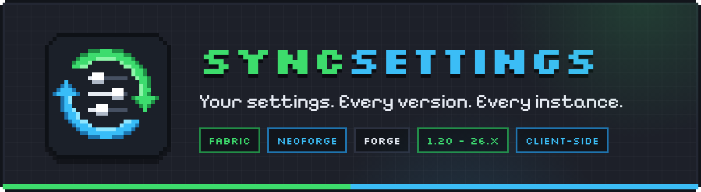

  <a href="LINK_HERE">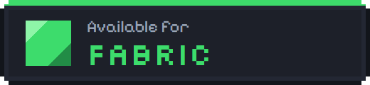</a>
  <a href="LINK_HERE">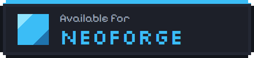</a>
  <a href="LINK_HERE">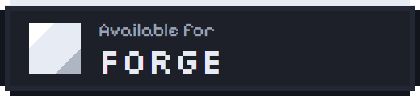</a>

  <a href="LINK_HERE"><b>Modrinth</b></a> ·
  <a href="LINK_HERE"><b>CurseForge</b></a> ·
  <a href="https://github.com/Rocket012/SyncSettings/wiki"><b>Wiki</b></a> ·
  <a href="https://github.com/Rocket012/SyncSettings/issues"><b>Issues</b></a>

SyncSettings keeps your Minecraft settings consistent across **instances** and **Minecraft versions**.
Set up your sensitivity, key bindings, video and sound settings once, save them to a **profile** and every other instance starts with exactly the same setup.

- Client-side only, no server install needed
- Minecraft **1.20 – 26.x**
- **Fabric**, **NeoForge** and **Forge**

This repository is the **public issue tracker and documentation hub** for SyncSettings.
The source code is intentionally **not public**.

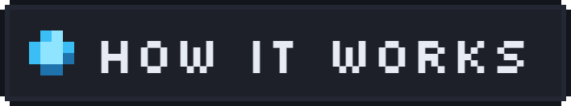

  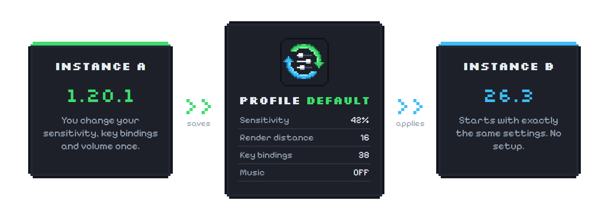

1. Change your settings in any instance (for example 1.20.1).
2. SyncSettings saves them into the active profile.
3. Start another instance (for example 26.3) and the profile is applied automatically. No setup.

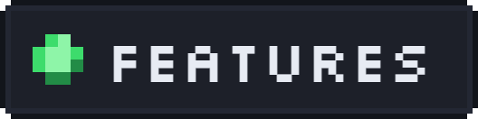

  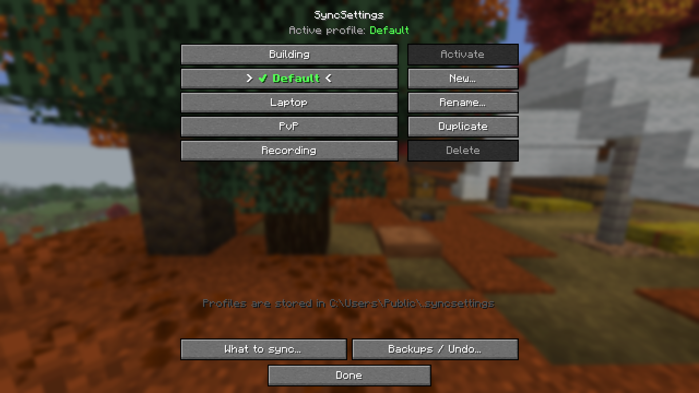

- **Profiles:** create, rename, duplicate, delete and switch between named profiles (e.g. *Building*, *PvP*, *Laptop*, *Recording*)
- **What to sync:** choose which settings are part of a profile
- **Backups / Undo:** restore earlier states of your settings if something goes wrong
- **Snapshots:** reads and writes common formats (`options.txt`, `config/*.json`, `config/*.toml`)
- **Migrations:** version-aware rules handle options that changed between Minecraft versions
- **Conflict handling:** safe fallback plus a clear change log (`syncsettings_changes.log`)
- **Shared storage:** profiles live outside your instances, so every launcher can use them

More details in the **[Wiki](https://github.com/Rocket012/SyncSettings/wiki)**.

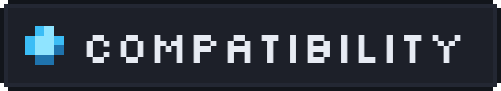

| | Supported |
|---|---|
| Minecraft | 1.20 – 26.x |
| Loaders | Fabric, NeoForge, Forge |
| Side | Client only |

Profiles are stored in a shared folder outside your instances:

| OS | Path |
|---|---|
| Windows | `C:\Users\Public\.syncsettings` |
| Linux / macOS | `~/.syncsettings` |

The exact path is shown at the bottom of the SyncSettings screen in game.

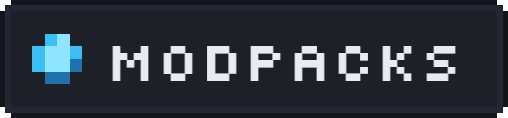

**Modpacks are allowed** to include SyncSettings **as an unmodified `.jar`**.

- **No reuploads / no mirrors:** do not rehost the `.jar` on other sites.
- **Use official sources:** download via the official Modrinth / CurseForge project pages.
- **No modified distributions:** forks, ports or modified builds may not be distributed without explicit permission.

For special permissions (mirrors, forks, ports) open an issue.

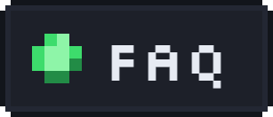

**Is the mod open source?**
No. SyncSettings is closed source (All Rights Reserved).

**Do I need it on the server?**
No. SyncSettings is client-side only.

**Can I use it in my modpack?**
Yes, under the modpack conditions above.

**Where are my profiles stored?**
See the table under Compatibility. The path is also shown in game.

**I found a bug, what now?**
Open an [issue](https://github.com/Rocket012/SyncSettings/issues) and follow the [Reporting Issues](https://github.com/Rocket012/SyncSettings/wiki/Reporting-Issues) guide in the wiki.

More questions are answered in the [Wiki FAQ](https://github.com/Rocket012/SyncSettings/wiki/FAQ).

## Reporting bugs / requesting features

Please check that you are on the **latest version** and that no similar issue exists. Then include:

- Minecraft version
- Loader (Fabric / NeoForge / Forge) + loader version
- SyncSettings version
- Launcher
- `latest.log` and, if relevant, `syncsettings_changes.log`
- Steps to reproduce, expected result vs. actual result

Do **not** upload tokens, account data or other personal information. Redact configs if needed.

## License

**All Rights Reserved (Closed Source).**
This repository contains documentation and issue tracking only.
